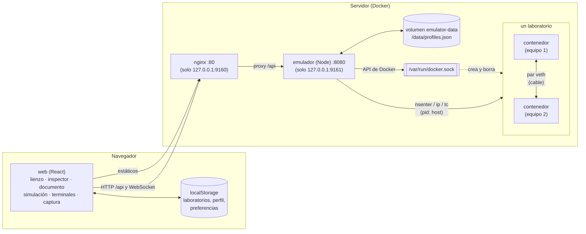
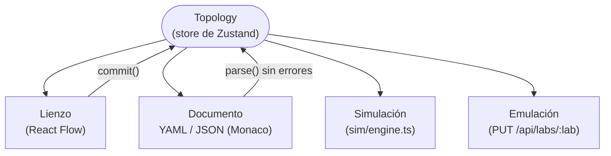
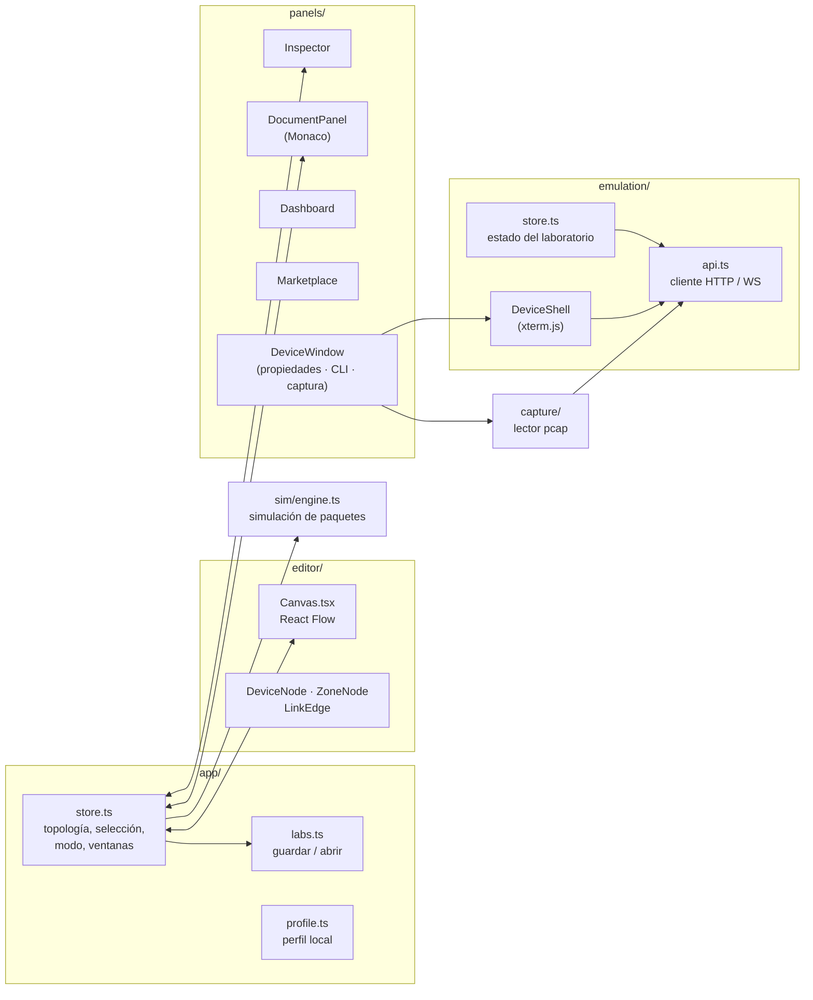

# Arquitectura

visualtracert-canvas es un monorepo con dos aplicaciones y un paquete compartido. Es una
herramienta local, sin cuentas: la web escucha solo en este equipo.

| Pieza | Dónde | Qué es |
|---|---|---|
| **web** | `apps/web` | El editor y la simulación: React 19, React Flow (lienzo), Monaco (documento), xterm.js (terminales) y Zustand (estado). Se sirve con nginx. |
| **emulador** | `apps/emulator` | El backend: un servicio Node sin frameworks (`node:http` y `ws`) que convierte un laboratorio en contenedores reales y cables veth, hablando con Docker por su socket. |
| **modelo** | `packages/model` | Lo que ambos comparten, en TypeScript puro: los tipos de la topología, el documento YAML/JSON, el catálogo de dispositivos e imágenes, las plantillas y las traducciones. |

## Vista general

- **La web funciona sola.** La simulación, el editor y el documento corren en el navegador; sin
  emulador, todo eso sigue funcionando y solo falta la emulación.
- **Todo se queda en este equipo.** El emulador es root en la práctica (socket de Docker,
  `privileged`, `pid: host`) y no hay cuentas, así que nada se publica: la web escucha en
  `127.0.0.1:9160` y el emulador, para desarrollo, en `127.0.0.1:9161`. Quien llega a la web llega
  a todo. Para usarlo desde otra máquina, un túnel SSH o un proxy que pida quién eres y lo diga
  en `X-User-Id`, `X-User-Name` y `X-User-Role`: con esas cabeceras, el emulador da a cada
  laboratorio su dueño y pone cuotas.
- **El modelo es la misma pieza en los dos lados.** La web serializa la topología a JSON con
  `serialize()` y el emulador la lee con el mismo `parse()`: los dos validan igual y producen los
  mismos mensajes de error, en el idioma de quien pide (`Accept-Language`).

## Una sola fuente de verdad

La topología (`Topology` en `packages/model/src/types.ts`) es el único objeto que describe un
laboratorio. El lienzo, el documento YAML/JSON, la simulación y la emulación son vistas de él:

- Cada cambio pasa por `commit()`, que guarda un paso de deshacer y escribe el laboratorio en
  `localStorage` (con un pequeño retardo).
- El documento solo reemplaza la topología si `parse()` no encuentra problemas; si los hay, los
  marca en su línea y el lienzo no cambia.
- La emulación no guarda nada propio: el documento es lo que se aplica en cada despliegue, y los
  contenedores son temporales (`--rm`).

## Dónde vive cada dato

| Dato | Dónde | Notas |
|---|---|---|
| Laboratorios | `localStorage` del navegador | Un documento JSON por laboratorio (`visual-tracert.lab.*`) |
| Perfil local y preferencias | `localStorage` | Nombre, foto, «sobre ti», tema, idioma, velocidad, animaciones |
| Disposición de paneles y barras | `localStorage` | Ancho del panel lateral, posición de las barras, registro |
| Perfiles de imagen | `/data/profiles.json` (volumen `emulator-data`) | Sobreviven al contenedor del emulador |
| Imágenes | Docker del servidor | Descargadas, construidas (perfiles) o construidas desde `vrnetlab/` |
| Estado de un laboratorio | Etiquetas de sus contenedores | `visual-tracert.lab`, `.device`, `.fingerprint`, `.image`: sobrevive a un reinicio del emulador |

Los laboratorios, el perfil y las preferencias viven en el navegador: para llevarlos a otro,
exporta el documento YAML/JSON de cada laboratorio desde la pestaña Documento.

## La web por dentro

- `app/store.ts` es el estado de la aplicación (la topología con su historial, la selección, el
  modo, las ventanas abiertas). `emulation/store.ts` es el estado de lo que corre en el servidor.
- `sim/engine.ts` es la simulación completa en el navegador: ARP, ICMP, traceroute, DHCP (con
  relay), DNS y TCP/HTTP, evento a evento.
- `capture/pcap.ts` decodifica en la página el pcap que manda el emulador (Ethernet, VLAN, ARP,
  IPv4/IPv6, ICMP, UDP, TCP, DNS, DHCP, HTTP).

El backend, en detalle, está en [El emulador por dentro](emulador.md).
