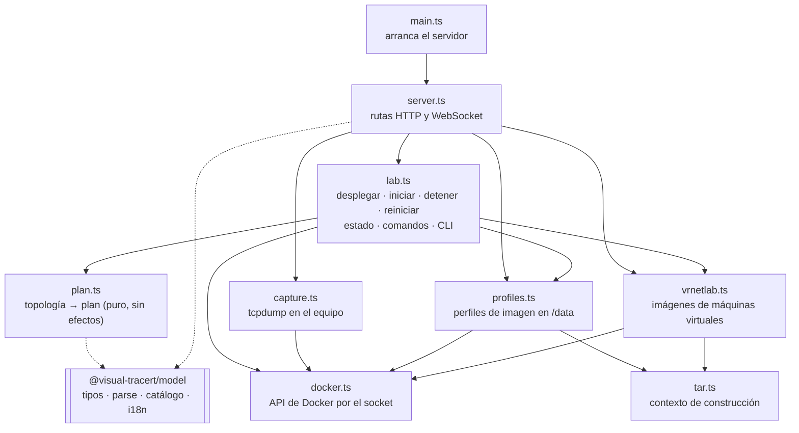
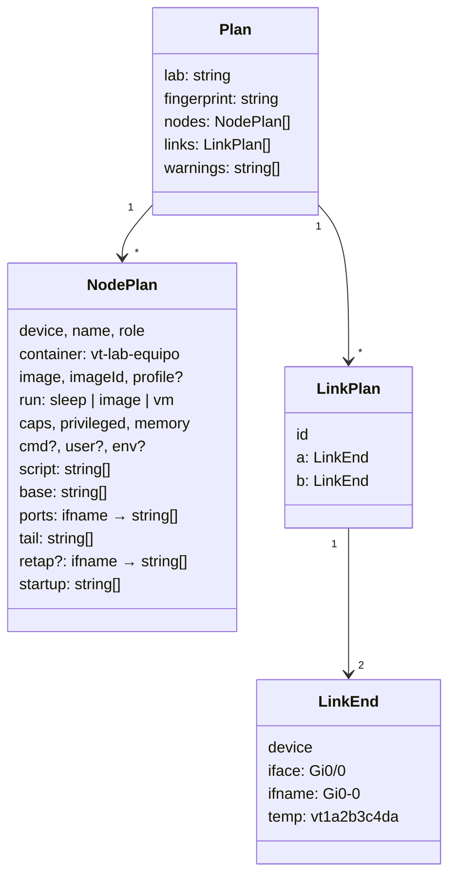
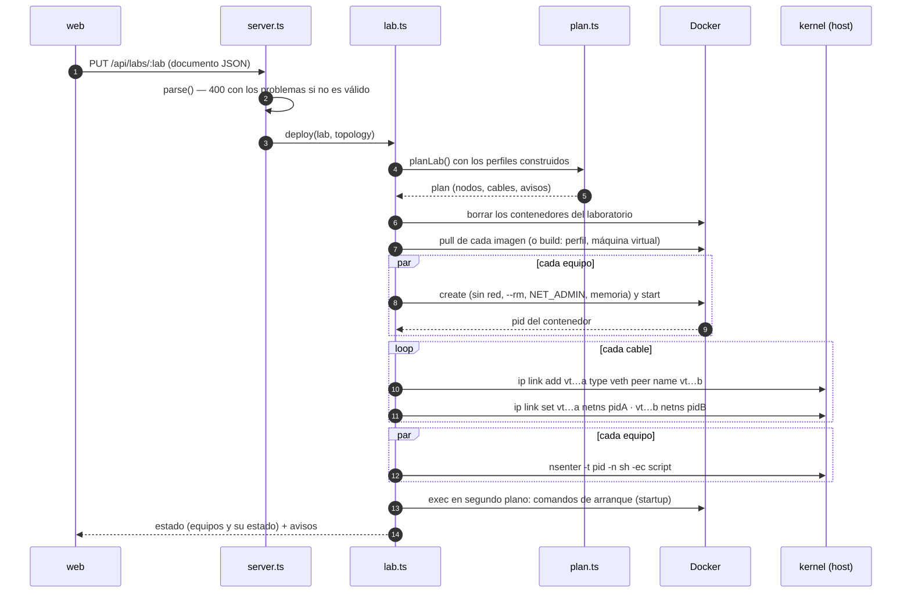
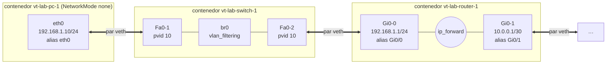
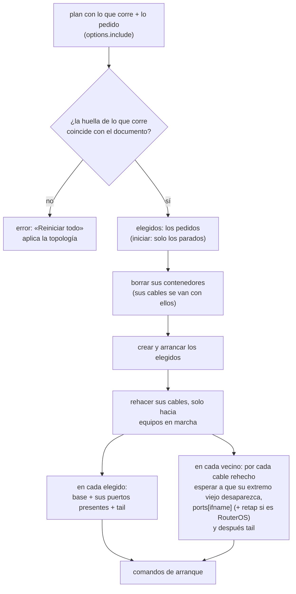
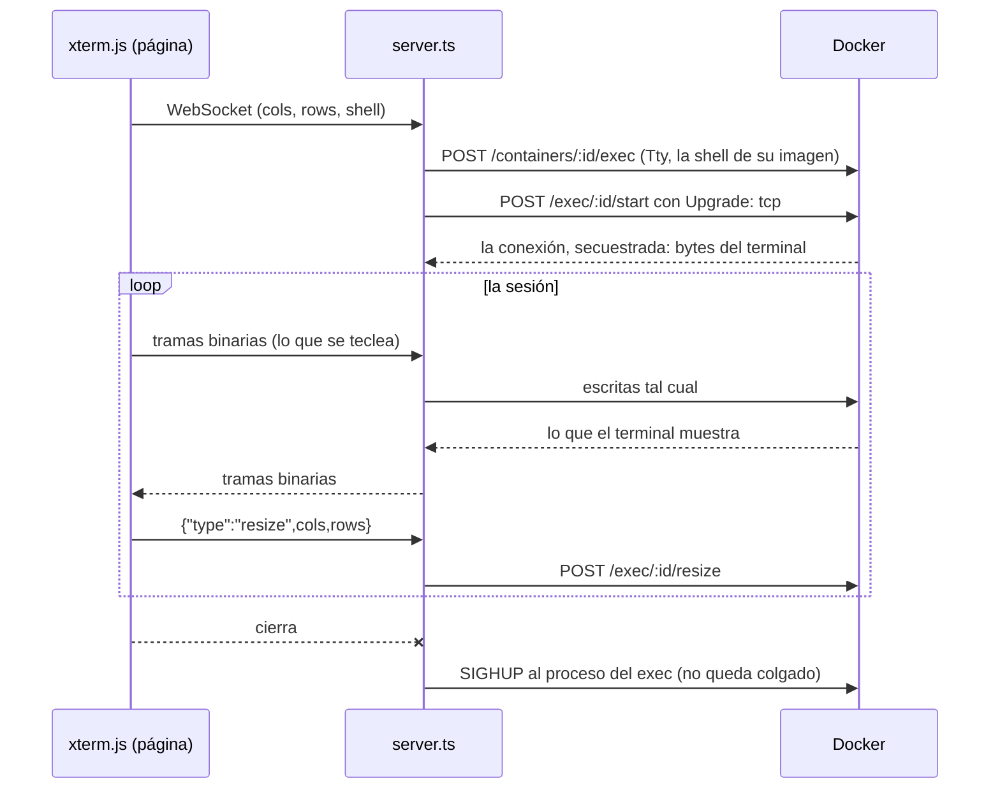
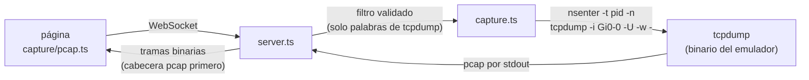
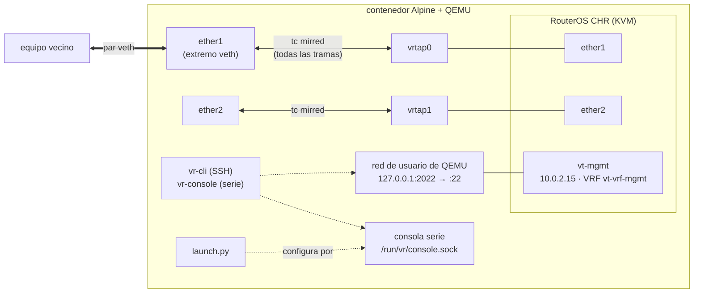
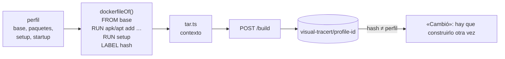

# El emulador por dentro

El emulador (`apps/emulator`) convierte un laboratorio en una red real:

- **cada equipo** es un contenedor de Docker sin red propia;
- **cada cable** es un par veth con un extremo en cada contenedor;
- **la configuración** de cada equipo (direcciones, puentes, rutas) se aplica desde fuera, entrando
  en su espacio de red con `nsenter`.

Es un servicio Node de unas 1.300 líneas sin frameworks: `node:http` para la API, `ws` para los
WebSocket y la API de Docker hablada directamente por su socket.

## Módulos

| Módulo | Responsabilidad |
|---|---|
| `server.ts` | Rutas, validación de entrada, idioma de la respuesta, y enganche de los WebSocket (CLI y captura). |
| `lab.ts` | Ejecuta planes: crea contenedores y cables, configura cada equipo, lee el estado desde las etiquetas de Docker. Serializa los cambios de cada laboratorio (uno a la vez). |
| `plan.ts` | **Puro**: de una topología saca qué contenedores, qué cables y qué comandos. Es lo que prueban los tests, sin Docker. |
| `docker.ts` | Lo mínimo de la API de Docker: imágenes (pull, build, inspect, remove), contenedores (create, start, inspect, list, remove) y exec, también interactivo (secuestro de la conexión con `Upgrade: tcp`). |
| `capture.ts` | Lanza `tcpdump` dentro del espacio de red de un equipo y devuelve su salida pcap. |
| `profiles.ts` | Guarda los perfiles de imagen en `/data/profiles.json` y los construye como imágenes locales. |
| `vrnetlab.ts` | Construye las imágenes de máquinas virtuales (RouterOS) desde `vrnetlab/<dir>` y les da `/dev/kvm` y `/dev/net/tun`. |

## El plan: de topología a red

`planLab(lab, topology, t, profiles, options)` es una función pura. Devuelve:

- **Qué equipos:** los que su topología inicia (`up`, o `hybrid` con `status: up`), más los que
  se piden a mano (`options.include`). Los que necesitan un contenedor privilegiado (SR Linux)
  solo si el servidor lo permite (`ALLOW_PRIVILEGED=1`).
- **Qué imagen:** la de su tipo (los genéricos, Alpine), o la de su perfil si está construido. Un
  equipo Alpine sin perfil propio corre como la **imagen de laboratorio** (`LAB_PROFILE`, la
  etiqueta `visual-tracert/profile-vt-lab`): Alpine con `iproute2` (el comando `bridge`),
  `dnsmasq`, `busybox-extras` (`httpd`), `tcpdump` y `bind-tools` (`dig`). El emulador la construye
  él solo al arrancar si no está; mientras tanto, esos equipos corren como Alpine sin más.
- **El script de cada equipo, en tres partes:**
  - `base`: lo que se hace una vez (`lo` arriba; el puente `br0` de un switch);
  - `ports`: lo de cada puerto cableado: renombrar el extremo temporal, poner su MAC y su alias
    (el nombre real, `Gi0/0`), y su dirección o su puesto en el puente con su VLAN;
  - `tail`: reenvío IPv4, rutas y puerta de enlace, con `ip route replace`, que se puede repetir
    sin efectos.
  El script completo es `base + ports + tail`. La división sirve para reconfigurar solo un
  puerto cuando su cable se rehace (ver Reiniciar).
- **Por rol:**

| Rol | Configuración |
|---|---|
| host | Direcciones de sus puertos y su puerta de enlace |
| router | Direcciones, `net.ipv4.ip_forward=1` y sus rutas estáticas |
| switch | Un puente Linux con `vlan_filtering`, cada puerto en su VLAN de acceso |
| SR Linux | Solo los puertos arriba; la configuración va por `sr_cli` al arrancar (`startup`) |
| RouterOS | Los puertos arriba sin IPv6; la configuración va a la máquina virtual por su entorno (`VR_CONFIG`) |

- **Servicios** (`serviceStartup`, en el `startup` de cada equipo Alpine, dentro del contenedor):
  - su servidor DNS en `/etc/resolv.conf` (o vacío: nunca el del anfitrión);
  - cada puerto con `dhcp` pide su dirección con `udhcpc -b`, que sigue pidiendo hasta que un
    servidor responde (el jugador puede arreglar el servidor mientras);
  - los rangos DHCP, los registros DNS (`host-record`) y el relay DHCP de un router
    (`dhcp-relay`) van a `/etc/vt/dnsmasq.conf` y arrancan un `dnsmasq`. Con registros, responde
    solo de lo suyo (`local=/#/`: NXDOMAIN o sin datos, nunca «refused», que musl toma por fallo);
  - un servidor web es `httpd -h /var/www` con una página con su nombre.
- **Avisos:** rutas cuyo siguiente salto no está en ninguna red cableada, perfiles no construidos,
  servicios que esperan a la imagen de laboratorio, equipos que no se inician, y los servicios de
  un RouterOS (aún no). La web los muestra en el panel de Emulación.
- **Huella** (`fingerprint`): un hash de la red (`networkFingerprint`, sin posiciones ni textos).
  Se guarda en las etiquetas de los contenedores: si la topología de la web ya no coincide, la
  web avisa de que cambió.

## Desplegar

`PUT /api/labs/:lab` con el documento JSON:

Si algo falla a mitad, se borra lo construido (los extremos que queden en el host y los
contenedores) y se devuelve el error.

### Cómo queda la red

- **Nombres:** Linux no admite `/` ni más de 15 caracteres en un nombre de interfaz, así que
  `Gi0/0` se llama `Gi0-0` dentro del contenedor y lleva `Gi0/0` como alias. La captura y los
  comandos encuentran el puerto por ese alias.
- **Sin red de Docker:** los contenedores arrancan con `NetworkMode: none`; solo tienen `lo`
  hasta que llegan sus cables.
- **`NET_ADMIN` en su propio espacio de red:** desde la CLI de un equipo se pueden cambiar sus
  direcciones y rutas, pero no las del host.

### Etiquetas

Cada contenedor lleva:

| Etiqueta | Para qué |
|---|---|
| `visual-tracert.lab` | A qué laboratorio pertenece: listar, borrar |
| `visual-tracert.device` | Qué equipo es |
| `visual-tracert.fingerprint` | La huella de la red desplegada |
| `visual-tracert.image` | Qué imagen del catálogo es (su CLI, sus comandos) |
| `visual-tracert.vrnetlab-hash` | (heredada de la imagen) con qué lanzador se construyó |

El estado de un laboratorio se lee siempre de Docker por estas etiquetas; el emulador no guarda
nada en memoria, así que sobrevive a un reinicio.

## Iniciar, detener y reiniciar equipos

`POST /api/labs/:lab/start | restart` con `{ devices, document }`, y `/stop` con `{ devices }`.

Detener es sencillo: se borran sus contenedores, y con su espacio de red desaparece cada par
veth entero, también el extremo del vecino. Iniciar y reiniciar son la misma operación
(`relaunch`):

- **Un equipo se puede iniciar aunque su topología no lo inicie:** se incluye en el plan a mano.
- **Las rutas hacia un equipo detenido no frenan al resto:** en un arranque parcial, las líneas
  de `tail` se ejecutan con `|| true`.
- **RouterOS como vecino:** su puerto en el contenedor está unido a la tarjeta de la máquina
  virtual con `tc`; al rehacerse el cable, `retap` vuelve a unirlos.

## La CLI de un equipo

`WS /api/labs/:lab/devices/:device/shell?cols=&rows=&shell=`

- La shell se elige entre las de la imagen (`shells` en `images.ts`): `vtysh` en FRR, `sr_cli` en
  SR Linux, la CLI de RouterOS por SSH (`vr-cli`) o su consola serie (`vr-console`), `bash`,
  `zsh`, `sh`.
- Los mensajes que llegan antes de que el exec esté listo se encolan.

## La captura de tráfico

`WS /api/labs/:lab/devices/:device/capture?iface=&filter=`

- `tcpdump` es el del emulador: no se instala nada en el equipo.
- El puerto se busca por su alias (`Gi0/0`); `any` captura en todos.
- El filtro solo admite letras, números, direcciones y operadores (`/^[A-Za-z0-9 .:/()!&|<>=\-[\]]{0,200}$/`):
  nunca llega a una shell.
- Una captura se corta sola a los 64 MB.

## Máquinas virtuales: RouterOS al estilo de vrnetlab

RouterOS solo existe como máquina virtual (el CHR de MikroTik). Se ejecuta dentro de un
contenedor, como hace [vrnetlab](https://github.com/vrnetlab/vrnetlab), con una imagen que el
emulador construye en el servidor desde `apps/emulator/vrnetlab/routeros/`.

**El lanzador** (`launch.py`):

1. Espera a que el emulador meta los cables (`VR_WAIT`).
2. Crea una tap por puerto, en orden (`VR_PORTS`: `ether1` es la primera tarjeta), y la une a
   su puerto con `tc … action mirred egress redirect` en los dos sentidos. A diferencia de un
   puente, `tc` deja pasar todas las tramas, también LLDP o STP.
3. Arranca QEMU (`qemu-system-aarch64` con UEFI en ARM64, o `qemu-system-x86_64`): KVM si existe
   `/dev/kvm`, 512 MB y 2 CPU. Cada arranque usa un disco nuevo sobre el original (overlay
   qcow2), así que la máquina empieza siempre limpia.
4. Entra por la consola serie: el primer `admin` sin contraseña, rechaza ver la licencia y pone
   la contraseña (`admin`).
5. Configura la gestión: la última tarjeta se llama `vt-mgmt` y va en su propio VRF, con el SSH
   escuchando solo ahí. Así no aparece en la tabla de rutas del laboratorio.
6. Aplica la configuración del laboratorio (`VR_CONFIG`): nombre, nombres de puerto,
   direcciones, clientes DHCP y rutas, en comandos de RouterOS.
7. Comprueba que el SSH responde; si no, vuelve a aplicar la gestión. Solo entonces escribe
   `/run/vr/ready`.

**Robustez de la consola:** RouterOS dibuja cada solicitud dos veces, así que el lector espera
0,6 s de silencio antes de dar una por buena. Si RouterOS reinicia su consola a mitad («Console
has crashed»), el lanzador vuelve a entrar y repite el comando.

**Versión de la imagen:** la imagen lleva como etiqueta el hash de su contexto
(`visual-tracert.vrnetlab-hash`). Si el emulador trae un lanzador nuevo, la imagen se reconstruye
sola al desplegar, y los equipos que corren con la anterior se marcan como desactualizados.

## Perfiles de imagen

Un perfil es una imagen del catálogo con paquetes, comandos al construir (`RUN`) y comandos al
arrancar. Se guarda en `/data/profiles.json` y se construye como `visual-tracert/profile-<id>`:

## Seguridad

- **El emulador es root en la práctica:** tiene el socket de Docker, es privilegiado y comparte
  los PID del host. Por eso no se publica: solo nginx lo alcanza (`/api`), y para desarrollo
  escucha en `127.0.0.1:9151`.
- **Solo con sesión:** nginx pregunta al servicio de cuentas (`apps/api`) antes de cada petición
  a `/api`, también al abrir una CLI o una captura por WebSocket. Sin sesión, 401; desde otra web
  (su `Origin`), 403, para que una página ajena no abra una shell con la cookie del usuario.
  Cambiar las imágenes y perfiles del servidor es solo de administradores. El emulador recibe
  quién llama en `X-User-Id`, `X-User-Name` y `X-User-Role`.
- **Cada laboratorio tiene dueño:** sus contenedores llevan la etiqueta `visual-tracert.owner`
  (y `.owner-name`). Otra cuenta no lo ve ni lo toca (404, también su CLI y su captura); un
  administrador sí. **Límite por cuenta:** como mucho `MAX_LABS_PER_USER` laboratorios (3) y
  `MAX_CONTAINERS_PER_USER` equipos (24) encendidos a la vez, sin límite para administradores.
  Sin cabeceras `X-User-*` (este equipo directamente, en desarrollo) todo es alcanzable.
- **Entradas validadas:** los identificadores de laboratorio (`[A-Za-z0-9_-]{1,64}`), los
  comandos (una lista cerrada, con destino validado como IP o nombre), el filtro de captura y
  los perfiles (paquetes y líneas con su propio patrón). Los textos del documento que llegan a
  una shell van entre comillas simples escapadas (`quote()` en `plan.ts`), y los de RouterOS,
  escapados para su CLI.
- **Contenedores privilegiados** (SR Linux): desactivados salvo con `ALLOW_PRIVILEGED=1`.
- **Contenedores temporales:** `--rm` y sus volúmenes anónimos se borran con ellos.
